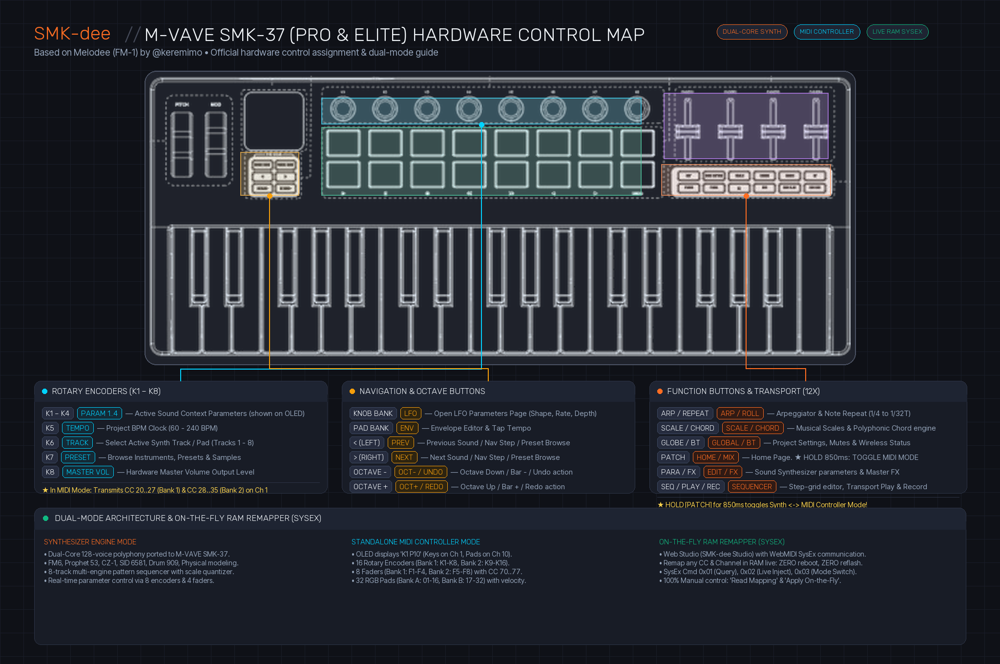

# SMK-dee

[](LICENSE)
[](https://github.com/djStrombo/SMK-dee/releases)
[](https://djstrombo.github.io/SMK-dee/)
[-cyan.svg)](https://github.com/djStrombo/SMK-dee)

**SMK-dee** is a full dual-core polyphonic synthesizer and dynamic MIDI controller firmware ported to the **M-VAVE SMK-37 (Pro & Elite)**. 

> ⚡ **Web Flasher & Sound Studio**: Flash your SMK-37 keyboard and configure hardware mappings directly from your browser: **[https://djstrombo.github.io/SMK-dee/](https://djstrombo.github.io/SMK-dee/)**

Based on the [Melodee](https://github.com/keremimo/melodee) multi-engine synthesizer for the M-VAVE FM-1 created by **keremimo** ([@keremimo](https://github.com/keremimo)).

---

## Hardware Control Map



---

## Overview & Key Additions (SMK-dee vs FM-1 Melodee)

While the original Melodee was designed for the compact FM-1 desktop unit, **SMK-dee** adapts and expands the entire engine to take full advantage of the **M-VAVE SMK-37 Pro & Elite** keyboard hardware:

| Feature | FM-1 (Melodee Original) | SMK-37 (SMK-dee Port) |
| :--- | :--- | :--- |
| **Form Factor** | Mini groovebox / desktop | 37-Key Keyboard Synthesizer & Controller |
| **Keyboard** | 16 mini keys / buttons | **37 full-travel velocity-sensitive keys** |
| **Pads** | Shared key matrix | **16 velocity RGB pads** (Dual bank: 32 pads) |
| **Rotary Encoders** | 4 context knobs | **8 physical continuous rotary encoders** (Dual bank: 16 knobs) |
| **Faders** | None | **4 physical sliders / faders** (Dual bank: 8 levels) via `SMK_FADMUX` ADC |
| **Physical Buttons** | FM-1 button matrix | **18 dedicated SMK-37 buttons** mapped to engine workflows |
| **Operation Modes** | Synthesizer Only | **Dual Mode:** Synthesizer Engine $\leftrightarrow$ Standalone MIDI Controller |
| **Mode Switching** | N/A | **Hold `PATCH + PARA`** for 600ms, or toggle remotely via Web Studio / SysEx |
| **Hardware & MIDI Remapper** | Static firmware tables | **Dynamic On-The-Fly RAM Remapper** via USB-MIDI SysEx (Zero reflash) |
| **Web Studio** | FM-1 Web Editor | **SMK-dee Studio & Lab:** In-browser Flasher, Button Mapper & MIDI CC Remapper |
| **Theme / OLED** | Stock FM-1 palette | Custom OLED boot title (**SMK-dee**), darkened Track 1 orange in BLACK theme, and About QR code |

---

## Dual-Mode Architecture

SMK-dee transforms the SMK-37 into a hybrid performance instrument with two distinct modes:

### 1. Synthesizer Engine Mode
- **Dual-Core Processing:** Full 128-voice polyphonic multi-engine synthesizer powered by the JieLi AC695x/AC696x dual-core SoC.
- **Sound Engines:**
  - **FM6:** 6-operator DX7-style frequency modulation synthesis with native feedback.
  - **Prophet 53:** Analog-style dual-oscillator subtractive poly-synth.
  - **CZ-1:** Casio phase-distortion synthesis with resonant waveforms.
  - **SID 6581:** Commodore 64 soundchip emulation with arpeggio tables and digi-drums.
  - **Drum 909:** Dedicated analog drum models (Kick, Snare, Toms, Hats, Claps).
  - **Physical Modeling:** String, bell, and Karplus-Strong acoustic resonators.
- **8-Track Sequencer:** 8 independent multi-timbral synth tracks with pattern chaining, live punch-in FX, parameter automation, and musical scale quantizer.
- **Master Effects:** Stereo Chorus, Delay with tone dampening, Hall Reverb, and Analog Distortion.

### 2. Standalone MIDI Controller Mode
- Holding physical **`PATCH + PARA`** together for **600ms** (or toggling via the Web Studio) seamlessly toggles between Synth Mode and MIDI Controller Mode.
- When active, the OLED screen displays:
  ```text
  K1 P10
  ```
  *(Indicating Keyboard on Channel 1, Drum Pads on Channel 10, with live CC values shown as controls move).*
- **Keyboard (37 keys):** Transmits velocity, octave shift, pitch bend strip, and modulation wheel on the Keyboard MIDI Channel.
- **Knobs (K1 – K16):** Send customizable continuous CC messages across Bank 1 and Bank 2.
- **Faders (F1 – F8):** Send customizable CC messages across Bank 1 and Bank 2.
- **RGB Pads (01 – 32):** Send velocity-sensitive Note or CC messages across Bank A and Bank B.

---

## Complete Hardware & MIDI Remapper Guide

One of the most powerful features of SMK-dee is its **Dynamic Hardware & MIDI Remapper**. 

In conventional synths and MIDI controllers, changing button behaviors, MIDI channels, or CC assignments requires either re-compiling the C source code or re-flashing the entire firmware image. In **SMK-dee**, all control tables live in dynamic RAM and are backed by a bidirectional SysEx protocol. 

Through the [SMK-dee Web Studio](https://djstrombo.github.io/SMK-dee/), you can customize every button, knob, fader, pad, channel, and CC in a visual interface, click **"Apply to Keyboard (RAM)"**, and the keyboard updates **in milliseconds without rebooting**. You can also click **"Save to Flash"** to store your custom layout permanently in non-volatile memory across power cycles.

The Remapper is divided into two specialized workspaces:

```
┌────────────────────────────────────────────────────────────────────────┐
│                        SMK-dee WEB STUDIO                              │
├──────────────────────────────────┬─────────────────────────────────────┤
│  Tab 1: Engine Remapper (Synth)  │  Tab 2: MIDI Controller Customizer  │
│  - 18 Physical Button Actions    │  - 4 Independent MIDI Channels      │
│  - 8 Rotary Encoders Routing     │  - 16 Knob CCs (Bank 1 & Bank 2)    │
│  - 4 Hardware Faders Volume/Cut  │  - 8 Fader CCs (Bank 1 & Bank 2)    │
│  - Real-time SysEx RAM Injection │  - 32 Pad Notes/CCs (Bank A & B)    │
└──────────────────────────────────┴─────────────────────────────────────┘
```

---

### Workspace 1: Engine Remapper (Synthesizer Mode)

This panel allows you to customize how the physical controls interact with the internal Melodee synthesis engine.

#### 1. The 18 Physical Buttons (BTN 00 – 17)
Each of the 18 buttons on the SMK-37 front panel can be assigned to any of the following engine actions or hardware utilities:

| Button Label | Default Action | Available Actions to Assign |
| :--- | :--- | :--- |
| **BTN 00: KNOB BANK** | `LFO` | `LFO`, `ENV`, `FX`, `SCL`, `HOME`, `EDIT`, `GLO`, `SAVE <`, `SAVE >`, `ARP`, `SEQ`, `PLAY`, `REC`, `OCT-`, `OCT+`, `NOTE REPEAT`, `CHORD`, `KNOB BANK`, `FADER BANK`, `OCTAVE TRANSPOSE`, or `[Disabled]` |
| **BTN 01: PAD BANK** | `ENV` | Any of the above engine or hardware actions |
| **BTN 02: < (LEFT)** | `SAVE <` (Presets) | Jump to Presets page, step left `<` across pages, undo navigation |
| **BTN 03: > (RIGHT)** | `SAVE >` (Save Page) | Jump to Save page, step right `>` across pages, redo navigation |
| **BTN 04: OCTAVE -** | `OCT- / BACK` | Octave transpose down. In menus: Back / Cancel. (Hold `PARA + OCT-`: Undo) |
| **BTN 05: OCTAVE +** | `OCT+ / OK` | Octave transpose up. In menus: Confirm / OK / Context. (Hold `PARA + OCT+`: Redo) |
| **BTN 06: ARP** | `ARP` | Toggle arpeggiator & style patterns |
| **BTN 07: NOTE REPEAT**| `REPEAT` | Note repeat / roll ratcheting (1/4 to 1/32T) |
| **BTN 08: SCALE** | `SCALE` | Musical scale quantizer (Major, Minor, Dorian, Phrygian, etc.) |
| **BTN 09: CHORD** | `CHORD` | Polyphonic chord harmonization generator |
| **BTN 10: GLOBE** | `GLOBAL` | Master settings, tempo BPM, MIDI clock, and track mutes |
| **BTN 11: BT** | `TAP TEMPO` | Tap 4 times to set project BPM (LED pulses at tempo) |
| **BTN 12: PATCH** | `HOME / MIX` | Main sound picker & mixer screen. (Combine with `PARA` for MIDI Mode) |
| **BTN 13: PARA** | `EDIT` | Synth parameter editor. (Hold with `OCT-` for Undo, `OCT+` for Redo) |
| **BTN 14: FX** | `MASTER FX` | Master effects rack (Delay, Reverb, Chorus, Drive) |
| **BTN 15: SEQ** | `SEQUENCER` | Step-sequencer pattern editor |
| **BTN 16: SEQ PLAY** | `PLAY / STOP` | Start / stop sequencer playback |
| **BTN 17: SEQ REC** | `REC / CLEAR` | Realtime / step recording & pattern erase |

#### 2. The 8 Rotary Encoders (K1 – K8)
The 8 continuous encoders can be routed to any engine parameter column:
- **K1 – K4:** Context Screen Parameters 1, 2, 3, 4 (controls whatever 4 values appear on the OLED).
- **K5:** Master Tempo (BPM selection from 60 to 240 BPM).
- **K6:** Track / Pad Selector (Select active synth tracks 1 through 8).
- **K7:** Preset & Sound Browser (Quick patch switching).
- **K8:** Master Volume Potentiometer (Main hardware output level).

#### 3. The 4 Hardware Faders (F1 – F4)
The physical sliders are read via a dedicated high-speed ADC multiplexer (`SMK_FADMUX`):
- **Default (Sound Level):**
  - **Bank 1:** Controls sound volume levels for Synth Tracks 1 to 4.
  - **Bank 2:** Controls sound volume levels for Synth Tracks 5 to 8.
- **Alternative Routing Options:** You can reassign any fader directly in the mapper to Master Volume, Filter Cutoff, Filter Resonance, or Global Tempo BPM.

---

### Workspace 2: MIDI Controller Customizer (MIDI Control Mode)

When you enter MIDI Controller Mode (by holding **`PATCH + PARA`** for 600ms, or clicking **"Toggle Mode on Keyboard"** in the Web Studio), the SMK-37 becomes a fully customizable standalone MIDI controller for your DAW, VST plugins, or external hardware synths.

#### 1. Four Independent MIDI Channels
Unlike basic controllers that force all controls onto a single global channel, SMK-dee provides **4 independent MIDI channels**:

| Section | Default Channel | Range | Use Case |
| :--- | :--- | :--- | :--- |
| **Keyboard Channel** | **Channel 1** | Ch 1 – 16 | Play piano, lead synths, or melodic plugins with full velocity, pitch bend, and modulation wheel |
| **Knobs Channel** | **Channel 1** | Ch 1 – 16 | Automate synth filters, plugin parameters, or VST macros independently |
| **Faders Channel** | **Channel 1** | Ch 1 – 16 | Control DAW mixer faders, expression (CC 11), or dynamics (CC 1) without interfering with keys |
| **Pads Channel** | **Channel 10** | Ch 1 – 16 | Trigger drum racks (e.g. Ableton Drum Rack, Battery, Superior Drummer) on standard drum channel 10 |

> 💡 **Multi-routing Example**: You can play a synth plugin on Channel 1 with the 37 keys, mix audio tracks on Channel 2 with the 4 faders, modulate an external hardware synthesizer on Channel 3 with the 8 knobs, and finger-drum a drum kit on Channel 10 with the 16 RGB pads—**all at the same time through a single USB cable!**

#### 2. 56 Assignable MIDI CCs
Every continuous control and pad can be customized to any MIDI CC number (0 – 127):
- **16 Knob CCs:**
  - **Bank 1 (K1 – K8):** Default CC 20, 21, 22, 23, 24, 25, 26, 27
  - **Bank 2 (K9 – K16):** Default CC 28, 29, 30, 31, 32, 33, 34, 35
- **8 Fader CCs:**
  - **Bank 1 (F1 – F4):** Default CC 70, 71, 72, 73 (or Volume CC 7, Expression CC 11)
  - **Bank 2 (F5 – F8):** Default CC 74, 75, 76, 77
- **32 Pad Notes / CCs:**
  - **Bank A (Pads 1 – 16):** Default CC 36 to 51 (or MIDI Note Mode)
  - **Bank B (Pads 17 – 32):** Default CC 52 to 67

#### 3. Instant Hardware Shortcuts (No Computer Needed!)
You can also change MIDI channels directly on the physical keyboard without opening the web studio:
- **Set Keyboard, Knobs & Faders Channel (1–16):** In MIDI mode, hold **`GLOBE`** and press any of the **first 16 keys** on the keyboard (Key 1 = Ch 1, Key 2 = Ch 2, ..., Key 16 = Ch 16).
- **Set Drum Pads Channel (1–16):** In MIDI mode, hold **`GLOBE + BT`** together and press any of the **first 16 keys** on the keyboard.

---

### Real-Time SysEx Protocol (For Developers & Advanced Users)

For custom integrations or DAW automation, SMK-dee listens for standard SysEx messages using educational manufacturer ID `0x7D` and model tag `'S'`, `'M'`, `'K'`:

```text
Header: F0 7D 53 4D 4B <COMMAND> ... F7
```

| Command | Name | Direction | Description |
| :--- | :--- | :--- | :--- |
| `0x01` | `GET_MAPPING` | Web $\rightarrow$ Keyboard | Requests the active configuration. Keyboard replies with `0x11` containing 104 bytes (18 buttons, 8 encoders, 4 faders, 4 channels, and 56 CCs). |
| `0x02` | `SET_MAPPING` | Web $\rightarrow$ Keyboard | Injects new button maps, channels, and CCs directly into RAM. Keyboard displays `MAPPING UPDATED` and replies with `0x12` ACK. |
| `0x03 0x01` | `SET_MODE_SYNTH` | Web $\rightarrow$ Keyboard | Forces keyboard into Synthesizer Engine Mode. |
| `0x03 0x02` | `TOGGLE_MODE` | Web $\rightarrow$ Keyboard | Toggles between Synthesizer Mode and MIDI Controller Mode. |
| `0x03 0x03` | `SAVE_FLASH` | Web $\rightarrow$ Keyboard | Burns the current RAM mapping into non-volatile flash memory permanently. |

---

## Default Hardware Controls Reference

### Navigation & Octave Cluster (Left Buttons under OLED)
| Button Label | SMK-dee Function | Description |
| :--- | :--- | :--- |
| **KNOB BANK** | `LFO` | Opens LFO editor page (Shape, Rate, Depth, Target) |
| **PAD BANK** | `ENV` | Envelope generator page & Tap Tempo |
| **`<` (LEFT)** | `PREV / <` | Previous sound, preset, pattern step, or undo navigation |
| **`>` (RIGHT)** | `NEXT / >` | Next sound, preset, pattern step, or redo navigation |
| **`OCTAVE -`** | `OCT- / BACK` | Shift keyboard octave down (-3..+3). In dialogs: Cancel / Back. (Hold `PARA + OCT-`: Undo take) |
| **`OCTAVE +`** | `OCT+ / OK` | Shift keyboard octave up (-3..+3). In dialogs: Confirm / OK. Hold: Context Menu. (Hold `PARA + OCT+`: Redo take) |

### Function & Performance Cluster (Right Buttons under Faders)
| Button Label | SMK-dee Function | Description |
| :--- | :--- | :--- |
| **ARP** | `ARP` | Toggle multi-pitch arpeggiator & style patterns |
| **NOTE REPEAT** | `REPEAT` | Note repeat & ratcheting roll (1/4 to 1/32T) |
| **SCALE** | `SCALE` | Musical scale quantizer (Major, Minor, Dorian, Pentatonic...) |
| **CHORD** | `CHORD` | Polyphonic chord voicing generator |
| **GLOBE** | `GLOBAL` | Global settings, project tempo, MIDI clock, and track mutes |
| **BT** | `TAP TEMPO` | Tap 4 times to set BPM tempo (LED pulses at active tempo) |
| **PATCH** | `HOME / MIX` | Home Page & Sound Mixer. (Combine with `PARA` to toggle MIDI Mode) |
| **PATCH + PARA** | `MIDI MODE` | **Hold together for 600ms: Toggle Synth $\leftrightarrow$ MIDI Controller Mode** |
| **PARA** | `EDIT / UNDO` | Sound parameter synthesis page. (Hold with `OCT-` for Undo, `OCT+` for Redo) |
| **FX** | `MASTER FX` | Master effects rack (Delay, Reverb, Chorus, Drive) |
| **SEQ** | `SEQUENCER` | Pattern step-grid editor (16 / 32 steps) |
| **SEQ PLAY** | `PLAY / STOP` | Play or stop pattern sequencer playback |
| **SEQ REC** | `REC / CLEAR` | Realtime / step recording & pattern clear |

---

## Installation & Flashing

### Requirements
- **Hardware:** M-VAVE SMK-37 (Pro or Elite model).
- **Cable:** Standard USB-C to USB-A/C cable connected directly to your computer.
- **Browser:** A Chromium-based browser supporting the Web MIDI SysEx API:
  - Google Chrome, Microsoft Edge, Brave, or Opera.
  - Compatible with Windows 10/11, macOS, Linux, and Chrome on Android (via USB OTG).
  - *(Note: Mozilla Firefox and Apple Safari do not support the Web MIDI SysEx API).*

---

### Method 1: In-Browser Web Flasher (Recommended for Everyone)
The fastest, easiest, and official way to install SMK-dee. No software installation, no Python, and no command line required:

1. Open **SMK-dee Web Studio** in Chrome, Edge, or Brave:
   👉 **[https://djstrombo.github.io/SMK-dee/](https://djstrombo.github.io/SMK-dee/)**
2. In section **01 // FIRMWARE SELECTION**, choose your hardware model:
   - Select **`SMK-37 Elite (37 Keys, OLED, Faders)`** if you have the Elite version.
   - Select **`SMK-37 Pro (37 Keys, OLED, Faders)`** if you have the Pro version.
3. Connect your SMK-37 to the computer via USB and click **Connect Keyboard**. When prompted by the browser, click **Allow** to grant Web MIDI SysEx permission.
4. In section **03 // FIRMWARE FLASHER**, click **Flash Keyboard Now**.
5. The flasher will transfer the Stage 1 OTA loader, enter update mode, and stream the firmware into flash.
6. Once the progress bar reaches 100%, the keyboard will reboot automatically and greet you with the **SMK-dee** OLED screen!

---

### Method 2: Offline / Local Web Studio (No Internet Required)
If you are working in an offline studio without an internet connection, or prefer serving the web app locally from your own machine, you can run the exact same Web Studio locally.

Because Chromium browsers automatically grant Web MIDI SysEx access on `http://localhost`, the local web flasher and hardware mapper work 100% offline:

```bash
# 1. Clone this repository to your computer
git clone https://github.com/djStrombo/SMK-dee.git
cd SMK-dee/web

# 2. Start a simple local HTTP server (Python 3 is built into macOS, Linux, and Windows)
python3 -m http.server 8080
```

Now open **`http://localhost:8080`** in Chrome, Edge, or Brave. All flashing, sound editing, and hardware remapping features are completely functional offline.

---

### Method 3: Command Line OTA Flasher (Python CLI)
For developers, Linux server setups, or headless environments, you can flash directly from the terminal using the included Python OTA flasher:

```bash
# 1. Clone the repository
git clone https://github.com/djStrombo/SMK-dee.git
cd SMK-dee

# 2. Install the lightweight Python MIDI library if needed
pip install mido python-rtmidi

# 3. Flash your keyboard model
# For SMK-37 Elite:
python3 tools/fm1_install.py web/firmware/smk-dee-elite.fwsc

# For SMK-37 Pro:
python3 tools/fm1_install.py web/firmware/smk-dee-pro.fwsc
```

---

## Returning to Factory Firmware (100% Reversible)

Flashing SMK-dee is completely safe and **100% non-destructive**. You can return to the stock M-VAVE factory firmware at any time in under 30 seconds:

1. Open **[SMK-dee Web Studio](https://djstrombo.github.io/SMK-dee/)** (or your local offline server).
2. Connect your SMK-37 keyboard via USB.
3. In section **01 // FIRMWARE SELECTION**, choose:
   - **`Factory Restore (V016) — SMK-37 Elite`** (if you have the Elite)
   - **`Factory Restore (V016) — SMK-37 Pro`** (if you have the Pro)
4. Click **Flash Keyboard Now**.
5. The keyboard will reboot with the original factory firmware restored.
*(Alternatively, you can flash `web/firmware/SMK-37_Elite_016.fwsc` or `web/firmware/SMK-37_Pro_016.fwsc` using Method 3 via command line).*

---

## Building from Source

To compile the firmware binary locally from source code:

### Prerequisites
- JL GCC toolchain (`pi32v2-none-elf` or AC695x/AC696x cross-compiler) or Docker.
- Python 3.10+

### Build Command
```bash
./build.sh
```

Or trigger the automated GitHub Actions workflow (`.github/workflows/build.yml`), which builds both `smk-dee-elite.fwsc` and `smk-dee-pro.fwsc` artifacts with verified JLFS checksums automatically.

---

## Credits & License

- **Melodee Sound Engine & Architecture:** Created by **keremimo** ([@keremimo](https://github.com/keremimo)) for the M-VAVE FM-1.
- **Original Felucca Base:** Created by Leo Kuroshita ([@kurogedelic](https://github.com/kurogedelic)), [Hügelton Instruments](https://hugelton.com).
- **SMK-dee Port, SMK-37 Hardware Adaptation, Dynamic SysEx RAM Remapper & Web Studio:** Ported and developed by **djStrombo** ([@djStrombo](https://github.com/djStrombo)).

This project is licensed under the **GNU General Public License v3.0 (GPL-3.0-only)**. See [LICENSE](LICENSE) for details.
